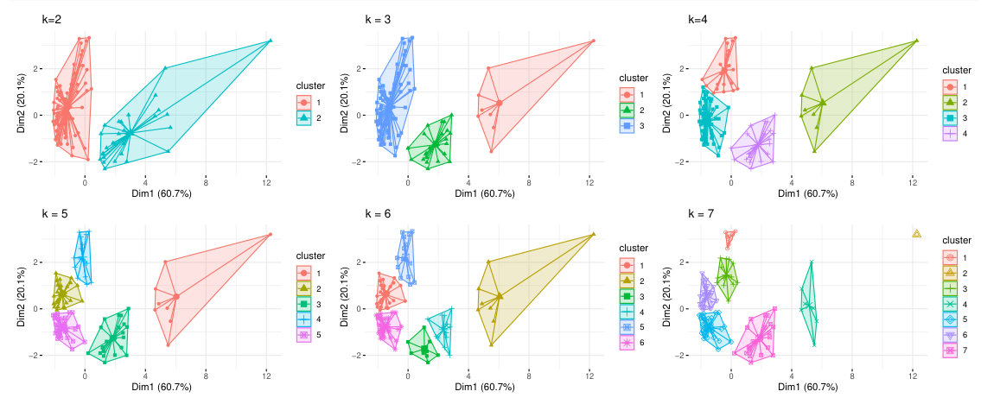
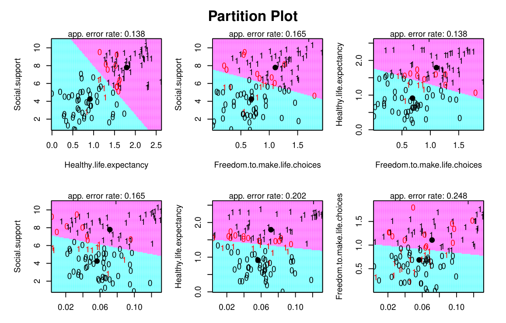
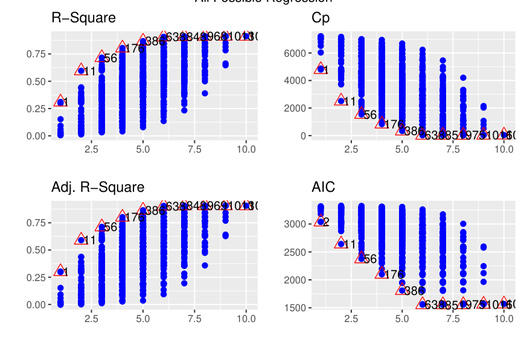
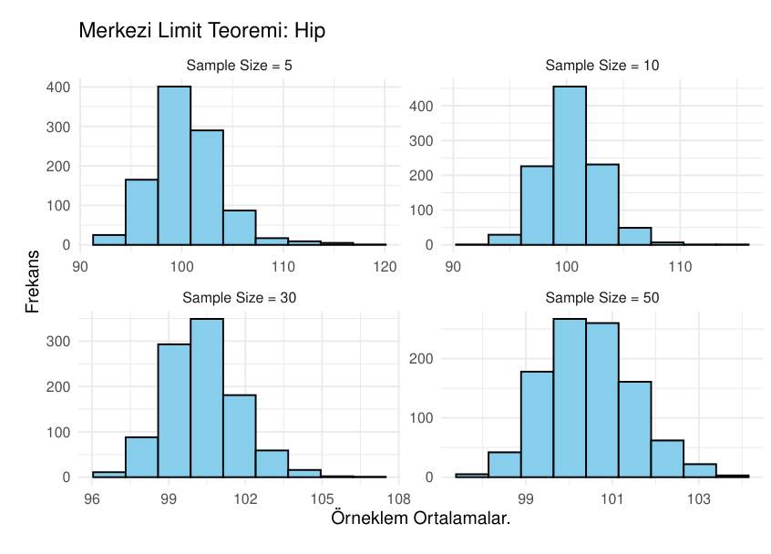

# M.Sc. Data Science Coursework

Assignments and final projects from my M.Sc. in Data Science at Dokuz Eylül University (2024–2025). Each folder has the code (R Markdown, R or Jupyter), the data where it can be shared, and the submitted report as a PDF. Reports and code comments are in Turkish; the summaries below are in English.

Larger projects from the same programme have their own repositories:

- [f1-2024-race-visualisation](https://github.com/ttasalti/f1-2024-race-visualisation): Exploratory Data Analysis and Data Visualisation final project (R, ggplot2, Shiny)
- [gan-cgan-faces](https://github.com/ttasalti/gan-cgan-faces): Deep Learning assignment on GANs and conditional GANs
- [Forecasting-UK-Refugee-Numbers-ARIMA-SVM-LSTM](https://github.com/ttasalti/Forecasting-UK-Refugee-Numbers-ARIMA-SVM-LSTM): Applied Time Series Analysis final project
- [DC-Capital-Bikeshare-Data-Viz-Analysis](https://github.com/ttasalti/DC-Capital-Bikeshare-Data-Viz-Analysis): Data Analytics for Operations Management final project

## Highlights

| | |
|---|---|
|  |  |
| k-means with k = 2 to 7 on the first two principal components (Unsupervised Learning, final) | LDA decision regions for pairs of predictors of happiness (Supervised Learning, final) |
|  |  |
| Best subset selection by R², adjusted R², Cp and AIC (Supervised Learning, homework 1) | Sampling distribution of the mean for n = 5, 10, 30, 50 (Probability and Statistics, final) |

## Courses and assignments

### Unsupervised Statistical Learning (DSM 5008)

| Folder | Topic |
|---|---|
| `unsupervised-learning/final` | Full clustering study: Hopkins statistic for cluster tendency, PCA, choice of distance metric, k-means, k-medoids, hierarchical clustering and DBSCAN, compared with elbow, silhouette and gap statistics |
| `unsupervised-learning/midterm` | PCA, k-means and k-medoids on country-level data |
| `unsupervised-learning/homework-pca-kmeans-pam` | PCA, k-means and PAM on the seeds dataset |

### Supervised Statistical Learning (DSM 5007)

| Folder | Topic |
|---|---|
| `supervised-learning/hw1-linear-regression` | Multiple linear regression on Formula 1 driver data: diagnostics, Cook's distance, VIF, stepwise and all-possible-subsets selection |
| `supervised-learning/midterm-missing-data-regression` | Missing value imputation with MICE, Box-Cox transformation and back-transformation, regression on the imputed data |
| `supervised-learning/hw3-xgboost-counterfactuals` | XGBoost classifier on the diabetes dataset and counterfactual explanations for true positive cases (Python) |
| `supervised-learning/final` | Classification of countries by happiness score (World Happiness Report 2019 data): Box-Cox with training-set lambdas, logistic regression, LDA, QDA, decision tree and random forest, compared with ROC curves |

### Deep Learning Methods and Applications (DSM 5014)

| Folder | Topic |
|---|---|
| `deep-learning/hw1-perceptron-neural-network` | A two-feature perceptron trained from scratch and a neural network for machine failure prediction (group work with Büşra Sulak and Mustafa Öngün) |

### Probability and Statistics for Data Science (DSM 5001)

| Folder | Topic |
|---|---|
| `probability-and-statistics/hw1` | Descriptive statistics and distributions of a player ability score (football player data from a Kaggle competition) |
| `probability-and-statistics/hw2-skewness-transformations` | Skewness analysis of South Asian population and migration data and choice of transformations |
| `probability-and-statistics/final` | Normality tests on body measurement data and a simulation of the central limit theorem |

### R for Statistical Computing and Programming (DSM 5003)

| Folder | Topic |
|---|---|
| `r-statistical-computing/midterm-r-miss-tastic` | Review of R-miss-tastic, a platform for missing data methods: how to generate missing values, imputation methods and their comparison in R |

### Applied Time Series Analysis (DSM 5012)

| Folder | Topic |
|---|---|
| `time-series/hw1` | ARIMA modelling of world population |
| `time-series/hw2` | ARIMA modelling of annual average temperature |
| `time-series/hw3-sarima` | Exponential smoothing and SARIMA model selection with forecasting |

### Data Analytics for Operations Management (DSM 5010)

| Folder | Topic |
|---|---|
| `operations-analytics/hw-blood-transfusion` | PCA on the blood transfusion service dataset |

## Running

The R code uses `tidyverse`, `ggplot2`, `factoextra`, `cluster`, `mice`, `MASS`, `caret`, `forecast` and related packages; each file loads what it needs. Set the working directory to the assignment folder before running it.
